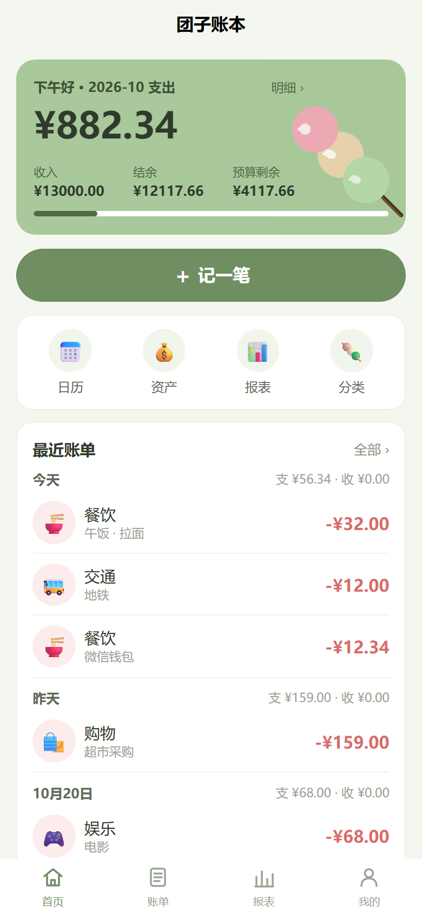

# 🍡 Dango Ledger · 团子账本

在线账本：所有平台的数据都走 HTTP 接口，服务端 SQLite 是唯一数据源；前端不落盘、不做离线同步。

## 结构

```
dango-ledger/
├── dango-backend/       Python + FastAPI + SQLite（CRUD / 统计 / 预算）
├── dango-frontend/      uni-app x 蒸汽模式（HBuilderX 项目根目录）
├── design/icon/         三彩团子图标（SVG + 多尺寸 PNG）
├── scripts/check.ps1    后端格式/lint/测试 + 可选前端编译
├── CONTRIBUTING.md      代码规范 / 提交规范
└── README.md
```

## 技术栈

- 后端：Python 3.10+ / FastAPI / Uvicorn / 标准库 sqlite3 / PyJWT / pytest
- 前端：uni-app x 蒸汽模式、Vue3 组合式 API、Pinia、内置组件（暂未引入 uni-ui x）
- 数据：全部走 `/api/*` 接口；前端无本地数据库、无业务数据缓存

## 界面

参考「小青账」的轻量卡片式布局，结合团子图标的抹茶绿 / 樱花粉 / 乳白：

- 首页：本月支出大卡片、预算剩余、记一笔、最近账单
- 账单：月切换、每日柱状图、搜索、类型筛选、按日分组
- 记一笔：分类图标网格、固定数字键盘、常用备注、再记 / 保存
- 报表：支出/收入分类占比与排行、近 6 个月趋势、预算设置
- 日历：月历热力、每日收支
- 资产：净资产 / 总资产 / 总负债、账户增删改
- 分类：图标网格、自定义颜色、长按删除
- 我的：登录注册、本月概览、功能入口



更多截图见 [docs/ui](docs/ui/README.md)。

## 快速开始

### 后端

```bash
cd dango-backend
python -m venv .venv
.venv\Scripts\Activate.ps1
pip install -r requirements.txt
python run.py
# http://127.0.0.1:8000/docs
python -m pytest tests -v
```

### 前端

用 HBuilderX 打开 `dango-frontend/`（uni-app x 项目），运行到 H5 / 微信小程序 / Android。

```bash
cd dango-frontend
npm install
```

接口地址在 `dango-frontend/config.uts` 中配置：

| 端 | API_BASE |
|---|---|
| H5 | `http://127.0.0.1:8000` |
| 小程序 / 真机 | `http://<电脑局域网IP>:8000` |

## 开发规范

- 代码风格、提交信息、接口约定见 [CONTRIBUTING.md](CONTRIBUTING.md)。
- 后端统一 Ruff（`pyproject.toml`）；提交前跑：

```powershell
.\scripts\check.cmd             # ruff format/check + pytest
.\scripts\check.cmd -Frontend   # 再加 HBuilderX Web 编译（需 HBuilderX 已启动）
```

- 前端为 uni-app x 蒸汽模式：样式只用简单 class（BEM），数据只走 Pinia → API，不落本地存储，更新接口用 PUT。

## 命名

中文：团子账本；英文：Dango Ledger；代码前缀 `dango`；环境变量 `DANGO_*`；数据库 `dango.db`。
